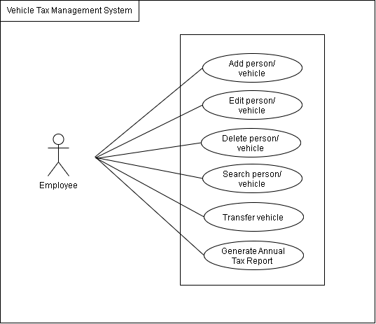
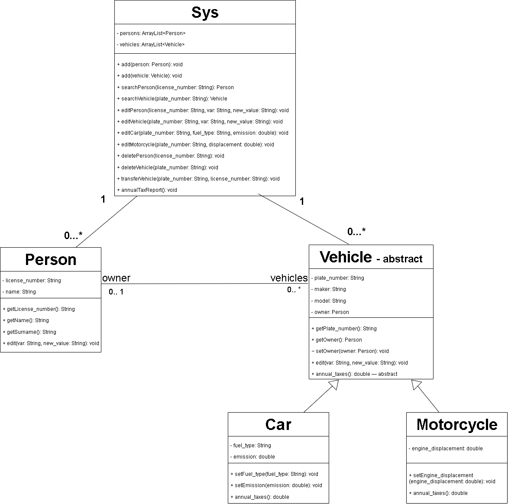
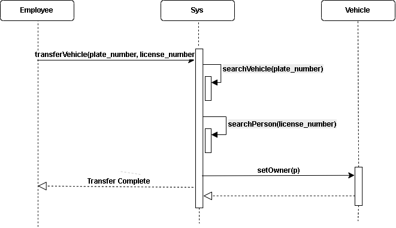
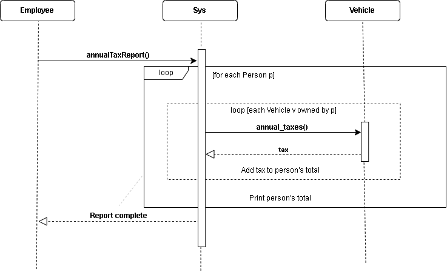

# Vehicle Tax Management System

A Java application for managing vehicle registrations, owners, and annual vehicle taxes.

The system allows users to manage persons and vehicles, transfer vehicle ownership, and generate an annual tax report for each registered person.

## Features

- Add, edit, search, and delete persons and vehicles.
- Manage two vehicle types: cars and motorcycles.
- Transfer vehicles between owners or leave vehicles without an owner.
- Calculate annual taxes depending on the vehicle type.
- Generate a tax report showing each person's vehicles, individual taxes, and total amount.

A person can own multiple vehicles, while each vehicle can have at most one owner. Persons without vehicles are also included in the annual tax report.

## Tax Calculation

The annual tax depends on the vehicle type and its characteristics.

| Vehicle type | Annual tax |
|---|---|
| Petrol car | 1.4 × CO₂ emissions |
| Diesel car | 1.8 × CO₂ emissions |
| Hybrid car | 1.2 × CO₂ emissions |
| Motorcycle | 0.1 × engine displacement |

The calculations are implemented in the `annual_taxes()` method, which is declared in the abstract `Vehicle` class and implemented separately in `Car` and `Motorcycle`.

## Project Structure

The application contains the following Java classes:

- **Sys:** Manages persons, vehicles, ownership transfers, and tax reports.
- **Person:** Stores information about a registered person.
- **Vehicle:** Abstract class containing the common vehicle attributes and methods.
- **Car:** Extends `Vehicle` and calculates taxes based on fuel type and emissions.
- **Motorcycle:** Extends `Vehicle` and calculates taxes based on engine displacement.
- **Main:** Demonstrates the system's functionality using example data.

The system uses `ArrayList` collections to store persons and vehicles.

## UML Diagrams

The following diagrams describe the system's structure and main operations.

### Use Case Diagram

### Class Diagram

### Sequence Diagram — Vehicle Transfer

### Sequence Diagram — Annual Tax Report

